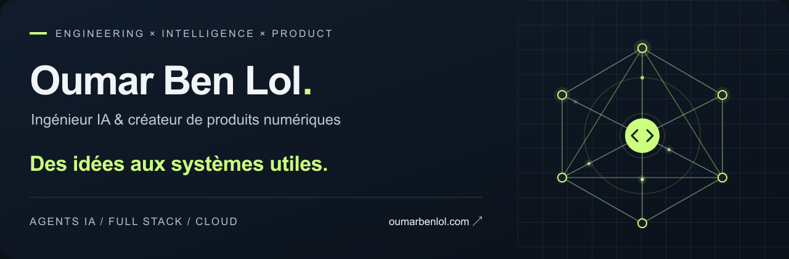

  <picture>
    <source media="(prefers-reduced-motion: reduce)" srcset="assets/banner.svg" />
    
  </picture>

  <a href="https://oumarbenlol.com"><strong>Portfolio ↗</strong></a>
  &nbsp; · &nbsp;
  <a href="https://github.com/oumar5?tab=repositories">Explorer mes dépôts</a>

### De l’intelligence artificielle aux produits qui servent.

Je suis **Oumar Ben Lol**, ingénieur IA et créateur de produits numériques. Je relie **IA agentique, architecture logicielle et culture produit** pour construire des systèmes utiles, du prototype à la production.

Mon fil conducteur : concevoir pour les contraintes réelles — sécurité, coûts, performance, accessibilité et faible connectivité.

### 01 / Ce que je construis

| Projet | Le problème que j’explore | Domaine |
| :--- | :--- | :--- |
| **[Chrysalide](https://github.com/oumar5/chrysalide-mcp)** | Transformer une consigne de développement en modification vérifiable dans une sandbox Git isolée. | Agents IA · MCP |
| **[Nexus Worker](https://github.com/oumar5/Nexus-Worker-MCP)** | Déléguer les tâches volumineuses à des modèles Worker économiques, sous la supervision du modèle principal. | Orchestration · MCP |
| **[DeepVox](https://github.com/oumar5/DeepVox)** | Explorer la reconnaissance et la traduction vocales hors ligne avec des représentations Codec2 à très bas débit. | Recherche · Audio |
| **[Demo Studio](https://github.com/oumar5/demo-studio)** | Capturer, narrer et rendre des démonstrations vidéo à partir d’interfaces web réelles. | Outils développeur |
| **[Invoice Bank Matching](https://github.com/oumar5/invoice-bank-matching-ai)** | Extraire les données des factures et les rapprocher des transactions bancaires avec l’IA. | IA documentaire |
| **[DATA COPERNICUS](https://github.com/oumar5/DATA-COPERNICUS)** | Analyser les données agricoles et météorologiques pour accompagner les décisions d’irrigation. | Data science |

### 02 / Mes terrains de jeu

**Intelligence artificielle** 
Agents · LLM · RAG · MCP · Évaluation · Data science

**Ingénierie produit** 
Python · TypeScript · FastAPI · Vue · React · Flutter

**Systèmes & livraison** 
Docker · Cloud · APIs · Architectures offline-first · Sécurité

### 03 / Ma façon de travailler

- **Partir du besoin.** Comprendre l’usage avant de choisir la technologie.
- **Rendre le résultat vérifiable.** Tester, mesurer et garder des traces utiles.
- **Construire pour le terrain.** Intégrer les contraintes de réseau, de coût et de maintenance.

---

**Un problème concret, une idée à construire ?** 
Retrouve mes projets et mes coordonnées sur **[oumarbenlol.com ↗](https://oumarbenlol.com)**.
